<div align="center">

# ⚔️ DungeonRPG

**A top-down pixel-art dungeon crawler built from scratch in Java.**
Procedural dungeons · three classes of danger · real-time combat · skills, loot and bosses.

[](https://adoptium.net/)
[](https://libgdx.com/)
[](https://github.com/libgdx/ashley)
[](https://gradle.org/)
[](LICENSE)
[](#-art-and-ai-disclosure)
[](#-roadmap)

[🇧🇷 Leia em português](README.pt-BR.md)

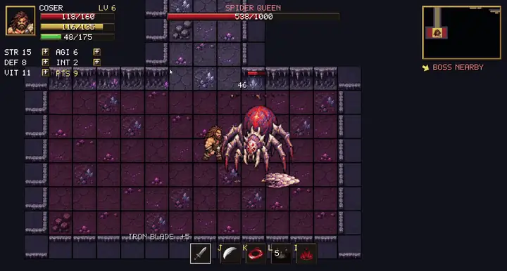

<sub>The Spider Queen fight, recorded from the game.</sub>

[**Play it**](#-getting-started) · [**Gallery**](#-gallery) · [**How it works**](#-architecture) · [**Contribute**](CONTRIBUTING.md)

</div>

---

## 📖 Table of contents

- [About](#-about)
- [Gallery](#-gallery)
- [Features](#-features)
- [Getting started](#-getting-started)
- [Controls](#-controls)
- [Game guide](#-game-guide)
- [Architecture](#-architecture)
- [Tech stack and why](#-tech-stack-and-why)
- [Project structure](#-project-structure)
- [What has been built](#-what-has-been-built)
- [Roadmap](#-roadmap)
- [Art and AI disclosure](#-art-and-ai-disclosure)
- [Contributing](#-contributing)
- [License](#-license)
- [Author](#-author)

## 🎮 About

DungeonRPG is a solo project inspired by *Dungeon Rampage*: pick a **Barbarian** or a **Mage**, choose a dungeon and
a difficulty, then fight through procedurally generated rooms, level up, equip the loot you find and hunt down the
boss waiting in the farthest room.

It started as an experiment to see how far a clean entity-component-system in Java could go, and grew into a small
but complete game loop: title screen, three dungeons, 39 monster types, skills, status effects, an XP and stat
system, weapon drops with five rarities and a game over screen.

<div align="center">
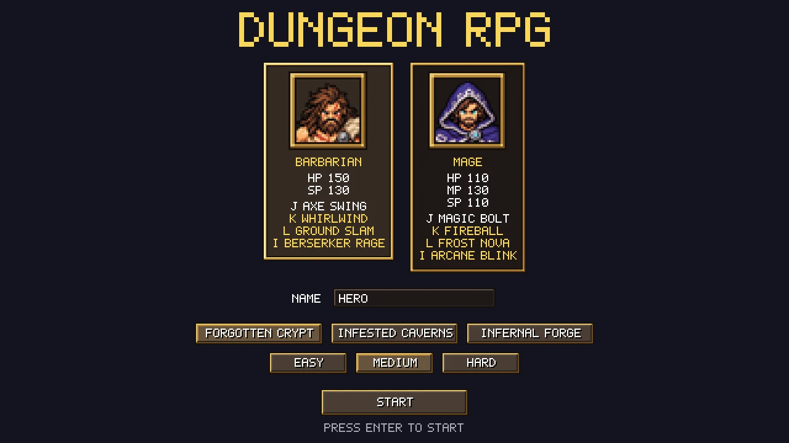
</div>

## 🖼️ Gallery

<table>
  <tr>
    <td align="center">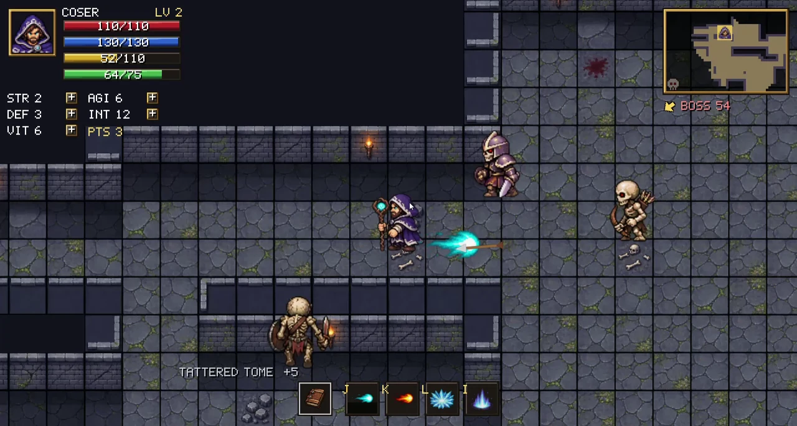<br><sub><b>Forgotten Crypt</b>: skeletons and archers</sub></td>
    <td align="center">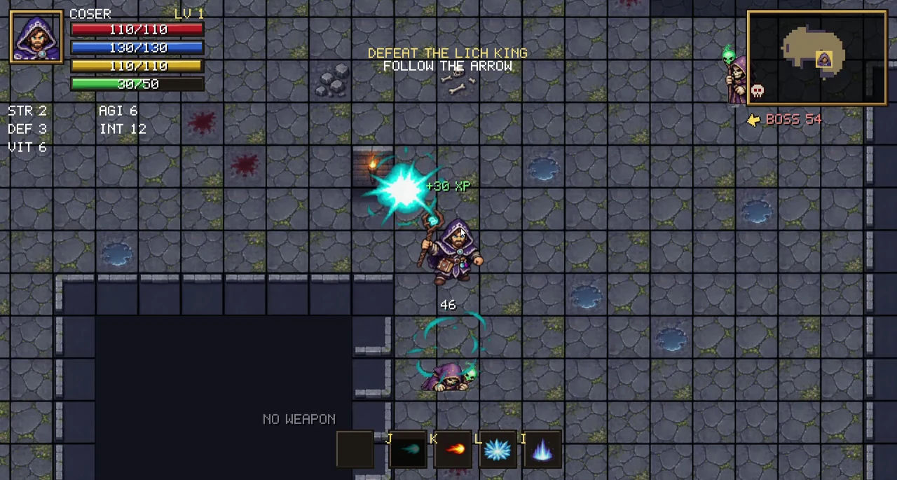<br><sub><b>Mage</b>: casting in the crypt</sub></td>
  </tr>
  <tr>
    <td align="center">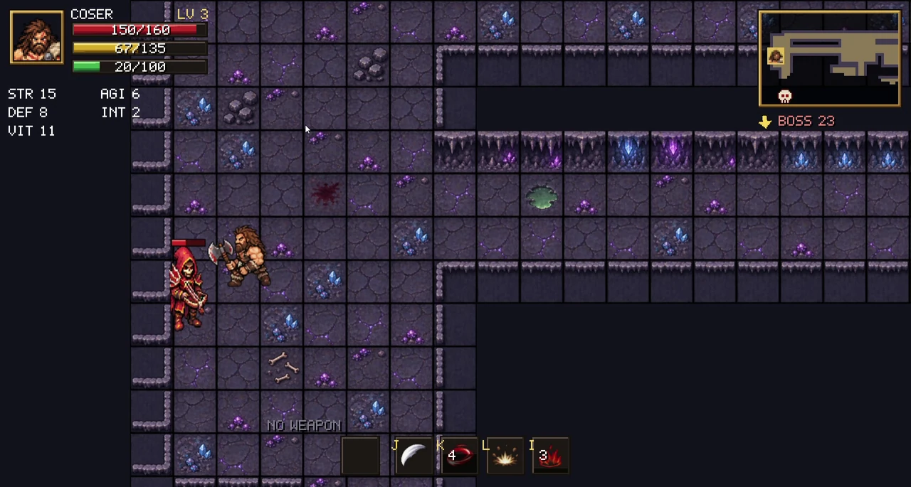<br><sub><b>Infested Caverns</b>: ranged monsters</sub></td>
    <td align="center">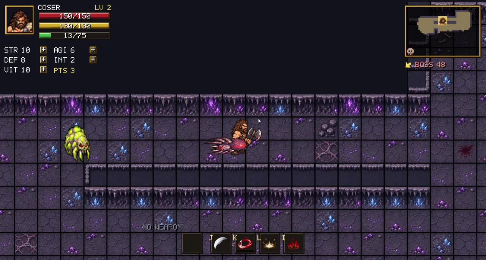<br><sub><b>Low stamina</b> and loot on the ground</sub></td>
  </tr>
  <tr>
    <td align="center">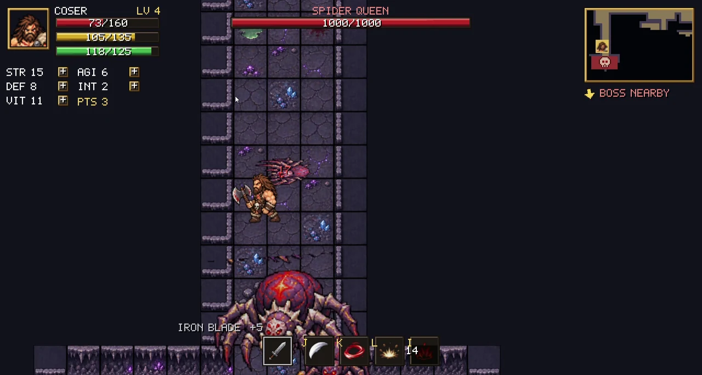<br><sub><b>Boss loot</b>: guaranteed drops</sub></td>
    <td align="center">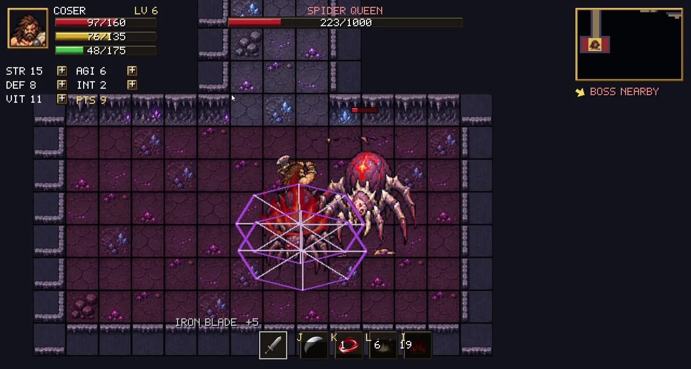<br><sub><b>Spider Queen</b>: web trap and summons</sub></td>
  </tr>
</table>

<details>
<summary><b>🎞️ Watch the gameplay clips</b> (click to expand)</summary>
<br>

| | |
|---|---|
| **Crypt: mage combat**<br>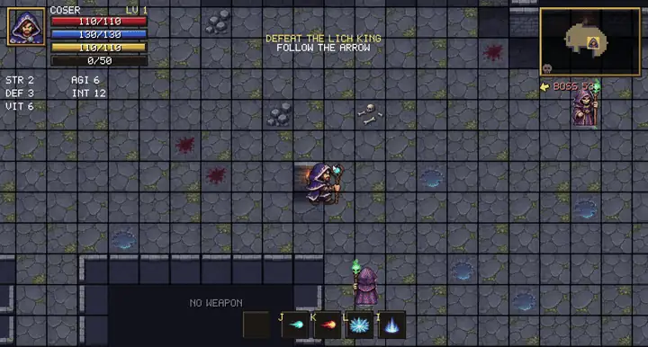 | **Crypt: battle and monsters**<br>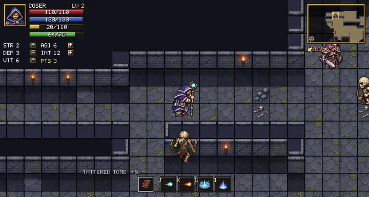 |
| **Caverns: walking and low stamina**<br>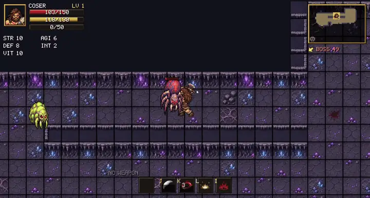 | **Caverns: barbarian vs a ranged monster**<br>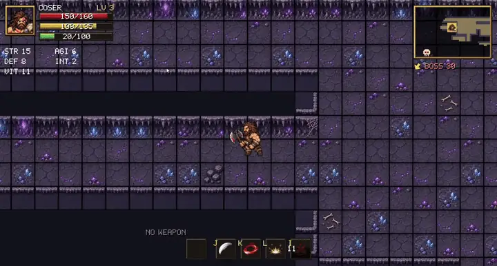 |
| **Spider Queen: item drop**<br>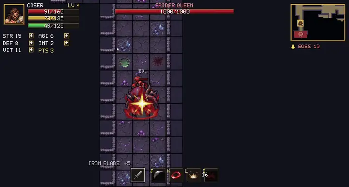 | **Game over**<br>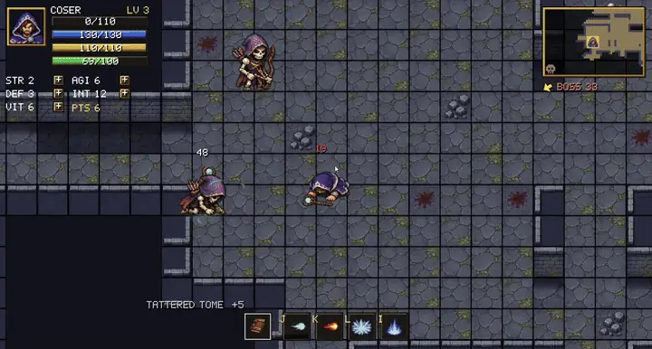 |

</details>

<details>
<summary><b>💀 Game over screen</b></summary>
<br>
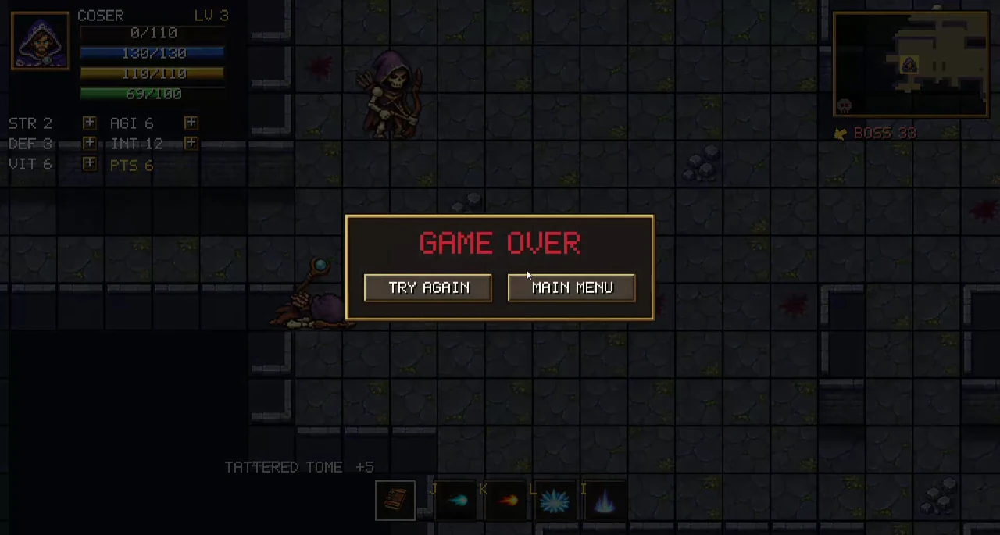
</details>

## ✨ Features

| | |
|---|---|
| 🗺️ **Procedural dungeons** | Rooms and L-shaped corridors generated from a seed, with fog of war on the minimap. The farthest room holds the boss. |
| 🏰 **3 dungeons** | Forgotten Crypt, Infested Caverns and Infernal Forge, each with its own tileset, monsters and boss. |
| 🧙 **2 classes** | Barbarian (HP and stamina) and Mage (HP, mana and stamina), with 4 abilities each. |
| 👹 **39 monster types** | 10 families in 3 tiers, minions and 3 bosses. Archers and casters keep their distance and shoot. |
| 🐉 **Bosses with abilities** | Lich King, Spider Queen and Magma Dragon use area attacks, telegraphed strikes and summons. |
| 🎒 **Loot** | 9 weapon families across 5 rarities (common to unique). Stronger monsters drop better items. |
| 📈 **RPG progression** | XP, levels and 3 stat points per level to spend on STR, AGI, DEF, INT and VIT. |
| 🩸 **Status effects** | Stun, slow, buffs and attached visual effects, shared by the player and the monsters. |
| 🧭 **Boss finder** | A compass arrow and a skull marker on the minimap point to the boss room. |
| 🎚️ **Difficulty** | Easy, Medium and Hard change monster and player speed. |
| 🖥️ **Pixel-perfect HUD** | Custom pixel-art HUD drawn at an integer scale, so it stays sharp at any window size. |

## 🚀 Getting started

### Prerequisites

- **JDK 21** (any distribution, e.g. [Temurin](https://adoptium.net/)).
- Nothing else: the Gradle wrapper downloads the build tool and all dependencies.

### Run

```bash
git clone https://github.com/Lcooser/DungeonRPG.git
cd DungeonRPG

./gradlew lwjgl3:run          # Linux and macOS
gradlew.bat lwjgl3:run        # Windows
```

<details>
<summary><b>Build a standalone jar</b></summary>

```bash
./gradlew lwjgl3:jar
java -jar lwjgl3/build/libs/DungeonRPG-0.1.0.jar
```

On macOS add `-XstartOnFirstThread` to the `java` command.
</details>

<details>
<summary><b>Useful Gradle tasks</b></summary>

| Task | What it does |
|---|---|
| `core:compileJava` | Compiles the game logic only |
| `lwjgl3:run` | Starts the game |
| `lwjgl3:jar` | Builds the runnable jar |
| `clean` | Removes build folders |
| `idea` | Generates IntelliJ project data |
</details>

## 🕹️ Controls

| Action | Keys |
|---|---|
| Move | `W` `A` `S` `D` |
| Sprint (uses stamina) | `Left Shift` |
| Basic attack (hold to keep attacking) | `J` or **left click** |
| Skill 1 | `K` or **right click** |
| Skill 2 | `L` or **middle click** |
| Skill 3 | `I` |
| Allocate stat points | Click the `+` buttons on the HUD after leveling up |
| Start / confirm | `Enter` |

Walk over a dropped weapon to equip it. Only upgrades are picked up; worse items stay on the floor.

> Developer keys are enabled in the current build: `1` takes damage, `2` spends a resource, `3` restores everything,
> `F1` switches class. Set `DEBUG_CONTROLS` to `false` in `GameScreen` to disable them.

## 📚 Game guide

<details open>
<summary><b>Classes and skills</b></summary>

| | 🪓 Barbarian | 🔮 Mage |
|---|---|---|
| Resources | HP 150, SP 130 | HP 110, MP 130, SP 110 |
| Basic attack `J` | Axe Swing | Magic Bolt |
| Skill `K` | Whirlwind | Fireball |
| Skill `L` | Ground Slam | Frost Nova |
| Skill `I` | Berserker Rage | Arcane Blink |
| Weapons | Axe, Greataxe, Sword, Hammer, Spear | Staff, Wand, Tome, Orb |

Skills spend mana (Mage) or stamina (Barbarian), and sprinting spends stamina. Running out of stamina exhausts the character: a tired animation and no sprinting until it recovers.
</details>

<details>
<summary><b>Dungeons and bosses</b></summary>

| Dungeon | Monster families | Boss |
|---|---|---|
| 🏚️ **Forgotten Crypt** | Skeleton Warrior, Skeleton Archer, Necromancer | **Lich King**: bolts, death nova, soul barrage, summons undead |
| 🕸️ **Infested Caverns** | Giant Spider, Venom Broodling, Cultist Hunter, Slime | **Spider Queen**: venom spit, web trap, brood summoning |
| 🔥 **Infernal Forge** | Fire Imp, Ember Knight, Magma Hound | **Magma Dragon**: fire breath, meteor rain, lava eruption |

Monster tier grows with the distance from the starting room: tier 1 near the spawn, tier 3 near the boss.
</details>

<details>
<summary><b>Loot and rarity</b></summary>

| Rarity | Damage multiplier |
|---|---|
| Common | ×1.0 |
| Rare | ×1.6 |
| Epic | ×2.4 |
| Legendary | ×3.4 |
| Unique | ×4.6 |

| Monster | Drop chance |
|---|---|
| Tier 1 | 12% |
| Tier 2 | 22% |
| Tier 3 | 35% |
| Minions | 25% |
| Boss | 100% |

Weak monsters rarely drop the top rarities; bosses roll from the best table.
</details>

<details>
<summary><b>Difficulty</b></summary>

| | Monster speed | Player speed |
|---|---|---|
| Easy | ×0.75 | ×1.10 |
| Medium | ×1.00 | ×1.00 |
| Hard | ×1.30 | ×0.95 |
</details>

## 🏗️ Architecture

The game is a classic **entity-component-system** on top of [Ashley](https://github.com/libgdx/ashley).
Entities are bags of small data components, and all behaviour lives in systems that run in a fixed order each frame.

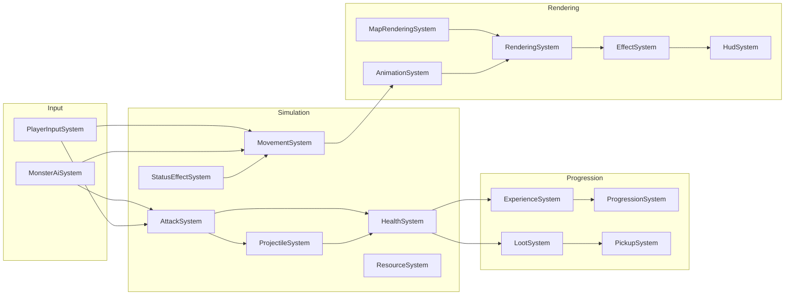

Content (monsters, skills, classes, rarities, dungeons) is defined in enums with fluent builders, so adding a
monster is one enum entry plus a sprite sheet. A `Theme` ties a dungeon together: tileset, monster families and boss.

The reasoning behind these choices is written down in
[**ADR 0001: libGDX with an Ashley ECS**](docs/adr/0001-libgdx-with-ashley-ecs.md).

## 🧰 Tech stack and why

| Layer | Choice | Why |
|---|---|---|
| Language | **Java 21** | Strong typing, great tooling and easy debugging. Enums and builders keep game content type-safe. |
| Engine | **libGDX 1.14** | Code-first 2D framework: full control over rendering and no editor or binary scene files. |
| Architecture | **Ashley ECS 1.7** | Keeps combat, AI, status effects and loot decoupled instead of growing a giant `Monster` class. |
| Desktop backend | **LWJGL3** | The standard libGDX desktop backend, with native access to OpenGL and the window. |
| UI | **Scene2D** + custom pixel HUD | Scene2D for the title screen, hand-drawn HUD for pixel-perfect scaling. |
| Build | **Gradle 9.8** (wrapper) | One command to build and run, no setup beyond a JDK. |
| Tooling | **Python** (Pillow, NumPy, SciPy) | Scripts that clean and align AI-generated sprite sheets into regular grids. |

## 🗂️ Project structure

```text
DungeonRPG/
├── core/                      Game logic shared by all platforms
│   └── src/main/java/com/dungeonrpg/game/
│       ├── components/        Data only: health, attack, stats, status effects, ...
│       ├── systems/           Behaviour: movement, combat, AI, loot, rendering, ...
│       ├── entities/          Factories for the player and the 39 monster types
│       ├── rpg/               Classes, abilities, stats, progression, difficulty
│       ├── item/              Weapons, rarities, drop tiers, item generation
│       ├── world/             Procedural map, dungeon themes, tileset renderer
│       ├── effects/           Particles, projectiles, floating text
│       ├── animation/         Sprite sheet animations
│       ├── ui/                HUD, minimap, hotbar, title screen widgets
│       └── screens/           Title screen and game screen
├── lwjgl3/                    Desktop launcher
├── assets/                    Sprites, tilesets, HUD atlas and fonts
├── tools/                     Python scripts to normalize sprite sheets
└── docs/                      ADRs and README media
```

## 🛠️ What has been built

A short log of how the game came together:

1. **World and collision**: procedural rooms and corridors, per-axis tile collision, a camera and an extend viewport.
2. **Animation**: directional idle, walk, attack, hurt and death animations driven by sprite sheets.
3. **Stats and HUD**: HP, mana and stamina, a custom pixel-art HUD, minimap with fog of war, hotbar and stat panel.
4. **Combat**: melee, projectiles, knockback, floating damage numbers and monster health bars.
5. **Skills and status effects**: three skills per class plus stun, slow and buffs.
6. **Title screen**: class, name, difficulty and, later, dungeon selection.
7. **RPG progression**: XP, levels, stat points and a level-up effect.
8. **Boss rooms**: boss compass, minimap marker, boss health bar and victory screen.
9. **Loot**: weapon drops, five rarities, tiered monsters and automatic equipping.
10. **Monster roster**: 39 monsters, ranged AI, boss abilities and summons.
11. **Dungeon themes**: three dungeons with their own tilesets, families and bosses.

## 🧭 Roadmap

- [ ] Replace the remaining prototype sprite sheets (some monsters and two bosses) with fully animated art
- [ ] Sound effects and music (the audio hooks already exist)
- [ ] Unit tests for progression, loot and damage formulas
- [ ] Armor and accessory slots
- [ ] Save files and a run history
- [ ] More dungeons and an endless mode

## 🎨 Art and AI disclosure

**All map, character, monster, item and effect images in this project were generated with AI image tools**, then
cleaned, aligned and animated into sprite sheets with the scripts in [`tools/`](tools). The pixel-art HUD
(atlas, font and portraits) was produced by the generation script in `tools/generate_hud_art.py`.

Some monster sheets are still procedural prototypes and will be replaced as better art is generated. The game
code, design and everything else were written by the author.

## 🤝 Contributing

Contributions, bug reports and ideas are welcome. Read [CONTRIBUTING.md](CONTRIBUTING.md) for the setup, commit
conventions and recipes for adding monsters, skills and dungeons.

## 📄 License

DungeonRPG is **source-available and free for non-commercial use** under the
[PolyForm Noncommercial License 1.0.0](LICENSE).

- ✅ You may read, run, fork, modify and share it for learning, research, hobby and other non-commercial purposes.
- ❌ You may **not** use it, its code or its art for commercial purposes, including selling it or including it in a
  paid product or service.
- 📌 Keep the `Required Notice` line from the [LICENSE](LICENSE) file in every copy.

Because commercial use is restricted, this license is not an OSI-approved "open source" license. It is meant to keep the
code open to everyone while keeping the project out of commercial products.

Third-party libraries keep their own licenses: libGDX and Ashley are licensed under Apache 2.0, LWJGL under BSD.

## 👤 Author

Made by **Luiz Coser**.

- GitHub: [@Lcooser](https://github.com/Lcooser)

If you enjoyed the project, a ⭐ on the repository helps a lot.
