<div align="center">

# ⚔️ DungeonRPG

**Um dungeon crawler top-down em pixel art, feito do zero em Java.**
Dungeons procedurais · três dungeons perigosas · combate em tempo real · skills, loot e chefes.

[](https://adoptium.net/)
[](https://libgdx.com/)
[](https://github.com/libgdx/ashley)
[](https://gradle.org/)
[](LICENSE)
[](#-arte-e-uso-de-ia)
[](#-roadmap)

[🇺🇸 Read in English](README.md)

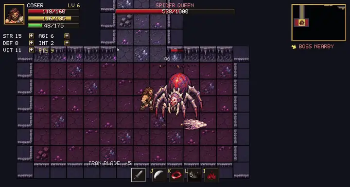

<sub>A luta contra a Spider Queen, gravada direto do jogo.</sub>

[**Jogar**](#-como-rodar) · [**Galeria**](#-galeria) · [**Como funciona**](#-arquitetura) · [**Contribuir**](CONTRIBUTING.md)

</div>

---

## 📖 Sumário

- [Sobre](#-sobre)
- [Galeria](#-galeria)
- [Recursos](#-recursos)
- [Como rodar](#-como-rodar)
- [Controles](#-controles)
- [Guia do jogo](#-guia-do-jogo)
- [Arquitetura](#-arquitetura)
- [Stack e por quê](#-stack-e-por-qu%C3%AA)
- [Estrutura do projeto](#-estrutura-do-projeto)
- [O que já foi feito](#-o-que-j%C3%A1-foi-feito)
- [Roadmap](#-roadmap)
- [Arte e uso de IA](#-arte-e-uso-de-ia)
- [Como contribuir](#-como-contribuir)
- [Licença](#-licen%C3%A7a)
- [Autor](#-autor)

## 🎮 Sobre

DungeonRPG é um projeto solo inspirado em *Dungeon Rampage*: escolha um **Bárbaro** ou um **Mago**, uma dungeon e uma
dificuldade, depois lute por salas geradas proceduralmente, suba de nível, equipe o loot que encontrar e vá atrás do
chefe que espera na sala mais distante.

Começou como um experimento para ver até onde um entity-component-system limpo em Java chegava, e virou um ciclo de
jogo pequeno mas completo: tela inicial, três dungeons, 39 tipos de monstros, skills, efeitos de status, sistema de XP
e atributos, armas com cinco raridades e tela de game over.

<div align="center">
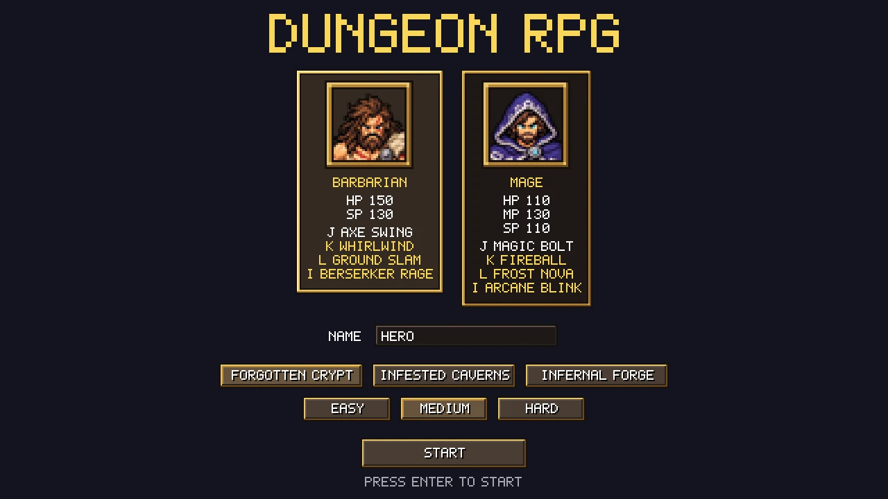
</div>

## 🖼️ Galeria

<table>
  <tr>
    <td align="center">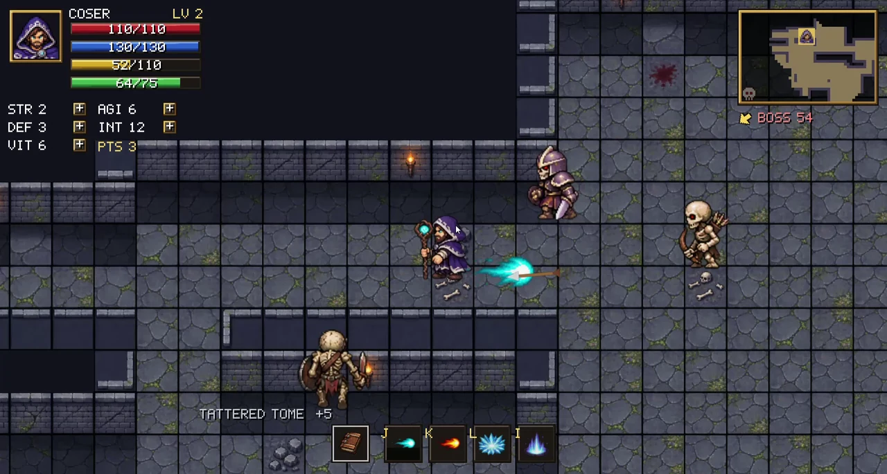<br><sub><b>Forgotten Crypt</b>: esqueletos e arqueiros</sub></td>
    <td align="center">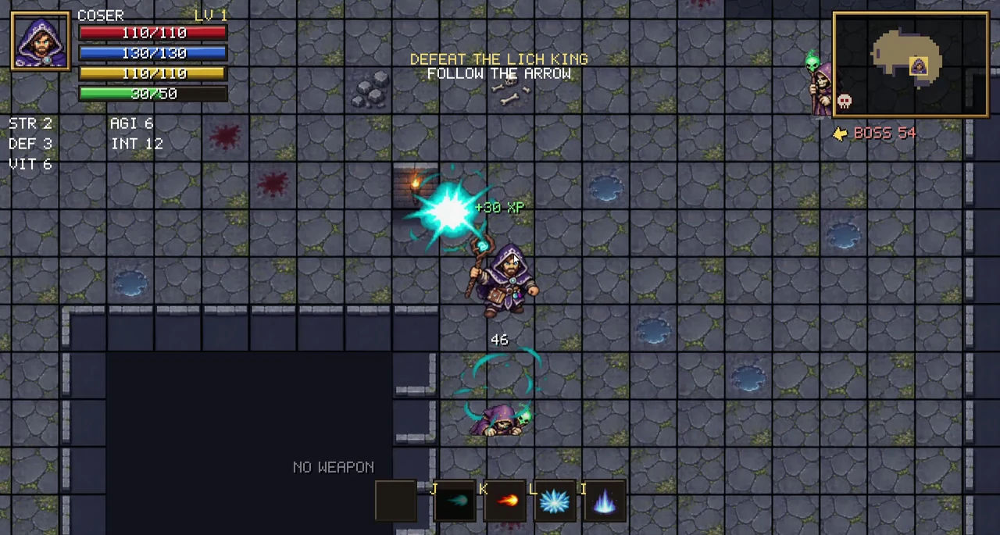<br><sub><b>Mago</b>: lançando skill na cripta</sub></td>
  </tr>
  <tr>
    <td align="center">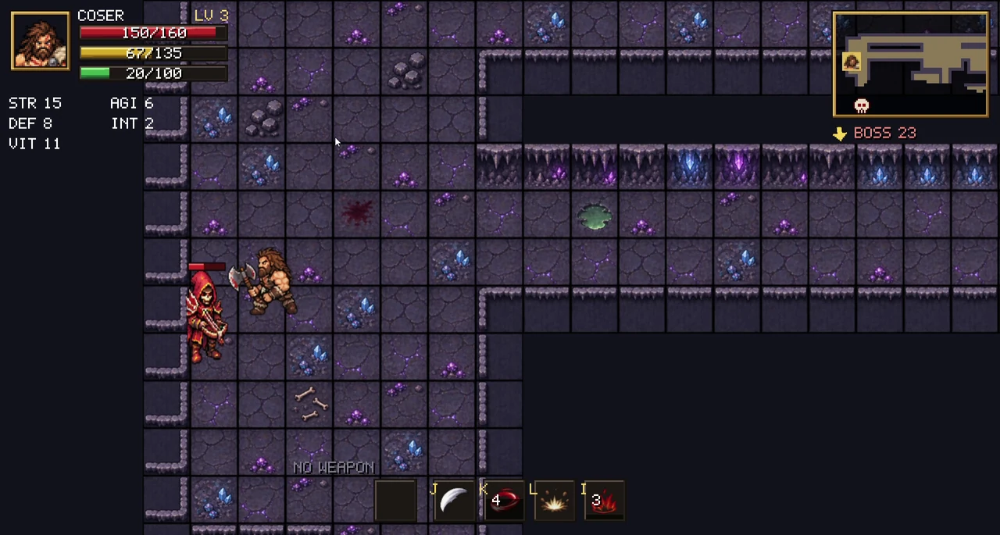<br><sub><b>Infested Caverns</b>: monstros à distância</sub></td>
    <td align="center">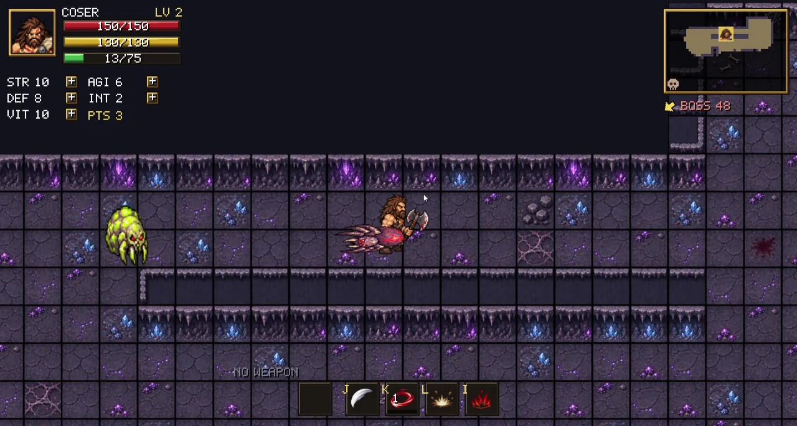<br><sub><b>Stamina baixa</b> e loot no chão</sub></td>
  </tr>
  <tr>
    <td align="center">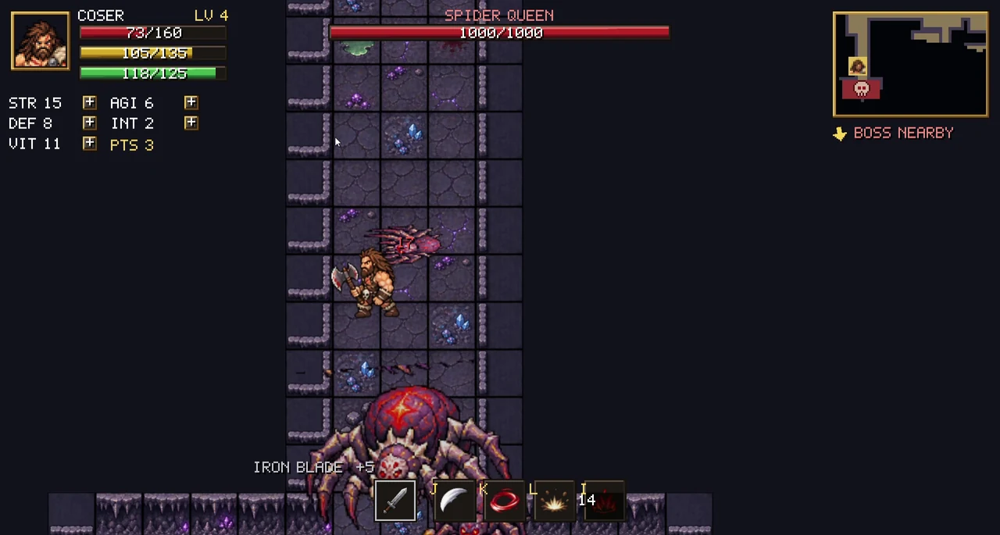<br><sub><b>Loot do chefe</b>: drops garantidos</sub></td>
    <td align="center">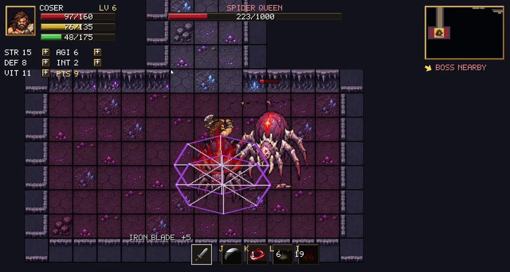<br><sub><b>Spider Queen</b>: teia e invocações</sub></td>
  </tr>
</table>

<details>
<summary><b>🎞️ Ver os clipes de gameplay</b> (clique para expandir)</summary>
<br>

| | |
|---|---|
| **Cripta: combate do mago**<br>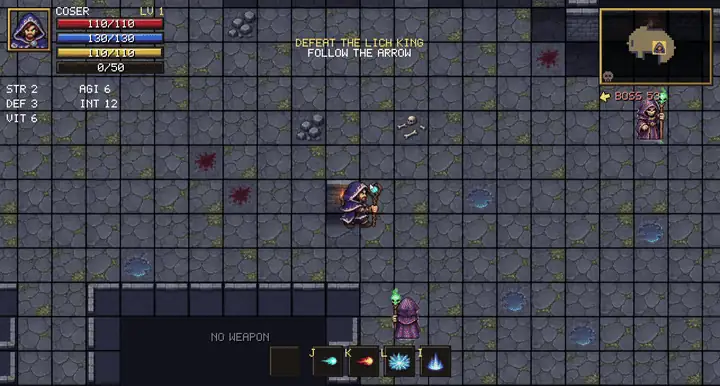 | **Cripta: batalha e monstros**<br>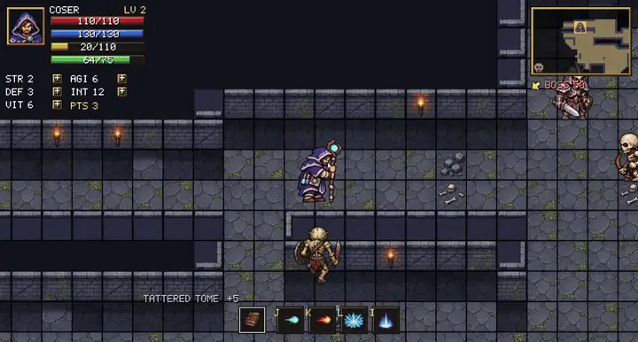 |
| **Cavernas: andando e stamina baixa**<br>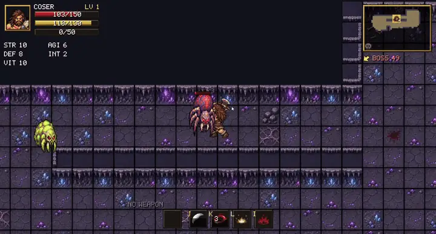 | **Cavernas: bárbaro contra monstro à distância**<br>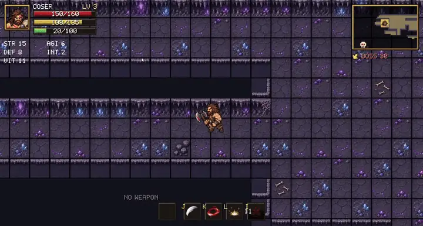 |
| **Spider Queen: drop de item**<br>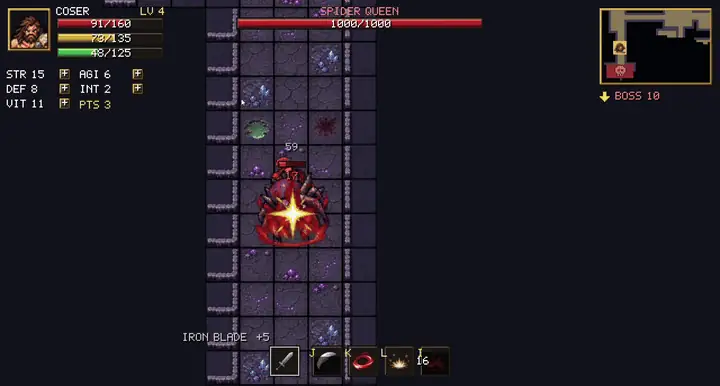 | **Game over**<br>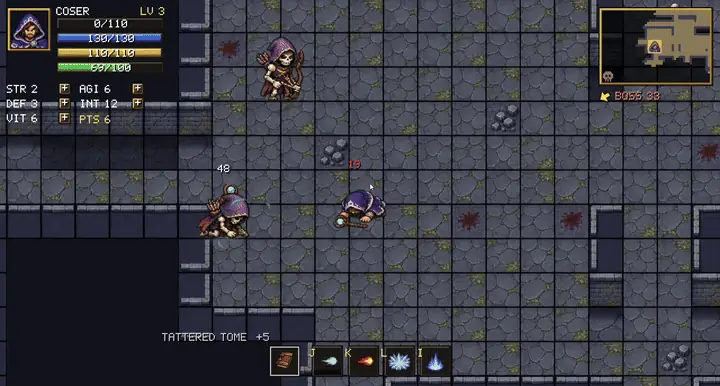 |

</details>

<details>
<summary><b>💀 Tela de game over</b></summary>
<br>
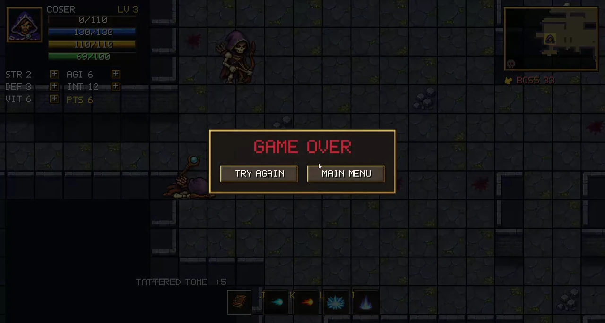
</details>

## ✨ Recursos

| | |
|---|---|
| 🗺️ **Dungeons procedurais** | Salas e corredores em L gerados a partir de uma seed, com névoa no minimapa. A sala mais distante guarda o chefe. |
| 🏰 **3 dungeons** | Forgotten Crypt, Infested Caverns e Infernal Forge, cada uma com tileset, monstros e chefe próprios. |
| 🧙 **2 classes** | Bárbaro (HP e stamina) e Mago (HP, mana e stamina), com 4 habilidades cada. |
| 👹 **39 tipos de monstros** | 10 famílias em 3 tiers, minions e 3 chefes. Arqueiros e magos mantêm distância e atiram. |
| 🐉 **Chefes com habilidades** | Lich King, Spider Queen e Magma Dragon usam ataques em área, golpes sinalizados e invocações. |
| 🎒 **Loot** | 9 famílias de armas em 5 raridades (comum a único). Monstros mais fortes dropam itens melhores. |
| 📈 **Progressão RPG** | XP, níveis e 3 pontos por nível para gastar em STR, AGI, DEF, INT e VIT. |
| 🩸 **Efeitos de status** | Stun, slow, buffs e efeitos visuais anexados, compartilhados entre jogador e monstros. |
| 🧭 **Localizador do chefe** | Uma seta de bússola e uma caveira no minimapa apontam a sala do chefe. |
| 🎚️ **Dificuldade** | Fácil, Médio e Difícil mudam a velocidade dos monstros e do jogador. |
| 🖥️ **HUD pixel-perfect** | HUD em pixel art desenhado em escala inteira, nítido em qualquer tamanho de janela. |

## 🚀 Como rodar

### Pré-requisitos

- **JDK 21** (qualquer distribuição, por exemplo [Temurin](https://adoptium.net/)).
- Mais nada: o Gradle wrapper baixa a ferramenta de build e todas as dependências.

### Rodar

```bash
git clone https://github.com/Lcooser/DungeonRPG.git
cd DungeonRPG

./gradlew lwjgl3:run          # Linux e macOS
gradlew.bat lwjgl3:run        # Windows
```

<details>
<summary><b>Gerar um jar executável</b></summary>

```bash
./gradlew lwjgl3:jar
java -jar lwjgl3/build/libs/DungeonRPG-0.1.0.jar
```

No macOS adicione `-XstartOnFirstThread` ao comando `java`.
</details>

<details>
<summary><b>Tarefas Gradle úteis</b></summary>

| Tarefa | O que faz |
|---|---|
| `core:compileJava` | Compila só a lógica do jogo |
| `lwjgl3:run` | Inicia o jogo |
| `lwjgl3:jar` | Gera o jar executável |
| `clean` | Remove as pastas de build |
| `idea` | Gera os dados do projeto IntelliJ |
</details>

## 🕹️ Controles

| Ação | Teclas |
|---|---|
| Mover | `W` `A` `S` `D` |
| Correr (gasta stamina) | `Shift esquerdo` |
| Ataque básico (segure para continuar atacando) | `J` ou **botão esquerdo** |
| Skill 1 | `K` ou **botão direito** |
| Skill 2 | `L` ou **botão do meio** |
| Skill 3 | `I` |
| Distribuir pontos de atributo | Clique nos botões `+` do HUD ao subir de nível |
| Iniciar / confirmar | `Enter` |

Passe por cima de uma arma caída para equipá-la. Só upgrades são pegos; itens piores ficam no chão.

> As teclas de desenvolvedor estão ativas na versão atual: `1` toma dano, `2` gasta um recurso, `3` restaura tudo,
> `F1` troca de classe. Mude `DEBUG_CONTROLS` para `false` em `GameScreen` para desativá-las.

## 📚 Guia do jogo

<details open>
<summary><b>Classes e skills</b></summary>

| | 🪓 Bárbaro | 🔮 Mago |
|---|---|---|
| Recursos | HP 150, SP 130 | HP 110, MP 130, SP 110 |
| Ataque básico `J` | Axe Swing | Magic Bolt |
| Skill `K` | Whirlwind | Fireball |
| Skill `L` | Ground Slam | Frost Nova |
| Skill `I` | Berserker Rage | Arcane Blink |
| Armas | Axe, Greataxe, Sword, Hammer, Spear | Staff, Wand, Tome, Orb |

Skills gastam mana (Mago) ou stamina (Bárbaro), e correr gasta stamina. Ficar sem stamina deixa o personagem exausto: animação de cansaço e sem correr até se recuperar.
</details>

<details>
<summary><b>Dungeons e chefes</b></summary>

| Dungeon | Famílias de monstros | Chefe |
|---|---|---|
| 🏚️ **Forgotten Crypt** | Skeleton Warrior, Skeleton Archer, Necromancer | **Lich King**: projéteis, death nova, soul barrage, invoca mortos-vivos |
| 🕸️ **Infested Caverns** | Giant Spider, Venom Broodling, Cultist Hunter, Slime | **Spider Queen**: cuspe de veneno, teia, invoca a ninhada |
| 🔥 **Infernal Forge** | Fire Imp, Ember Knight, Magma Hound | **Magma Dragon**: sopro de fogo, chuva de meteoros, erupção de lava |

O tier dos monstros cresce com a distância da sala inicial: tier 1 perto do spawn, tier 3 perto do chefe.
</details>

<details>
<summary><b>Loot e raridade</b></summary>

| Raridade | Multiplicador de dano |
|---|---|
| Common | ×1.0 |
| Rare | ×1.6 |
| Epic | ×2.4 |
| Legendary | ×3.4 |
| Unique | ×4.6 |

| Monstro | Chance de drop |
|---|---|
| Tier 1 | 12% |
| Tier 2 | 22% |
| Tier 3 | 35% |
| Minions | 25% |
| Chefe | 100% |

Monstros fracos raramente dropam as raridades mais altas; chefes sorteiam da melhor tabela.
</details>

<details>
<summary><b>Dificuldade</b></summary>

| | Velocidade dos monstros | Velocidade do jogador |
|---|---|---|
| Fácil | ×0.75 | ×1.10 |
| Médio | ×1.00 | ×1.00 |
| Difícil | ×1.30 | ×0.95 |
</details>

## 🏗️ Arquitetura

O jogo é um **entity-component-system** clássico sobre o [Ashley](https://github.com/libgdx/ashley).
Entidades são conjuntos de componentes de dados pequenos, e todo o comportamento vive em sistemas que rodam em ordem
fixa a cada frame.

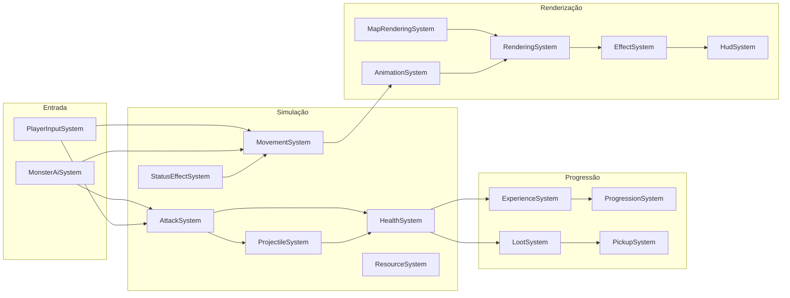

O conteúdo (monstros, skills, classes, raridades, dungeons) é definido em enums com builders fluentes, então adicionar
um monstro é uma entrada no enum mais um sprite sheet. Um `Theme` amarra a dungeon: tileset, famílias de monstros e chefe.

O raciocínio por trás dessas escolhas está registrado em
[**ADR 0001: libGDX com Ashley ECS**](docs/adr/0001-libgdx-with-ashley-ecs.md) (em inglês).

## 🧰 Stack e por quê

| Camada | Escolha | Por quê |
|---|---|---|
| Linguagem | **Java 21** | Tipagem forte, ótimo ferramental e depuração fácil. Enums e builders deixam o conteúdo do jogo type-safe. |
| Engine | **libGDX 1.14** | Framework 2D orientado a código: controle total da renderização, sem editor nem cenas binárias. |
| Arquitetura | **Ashley ECS 1.7** | Mantém combate, IA, status e loot desacoplados, em vez de crescer uma classe `Monster` gigante. |
| Backend desktop | **LWJGL3** | O backend desktop padrão do libGDX, com acesso nativo ao OpenGL e à janela. |
| UI | **Scene2D** + HUD pixel próprio | Scene2D na tela inicial, HUD desenhado à mão para escala pixel-perfect. |
| Build | **Gradle 9.8** (wrapper) | Um comando para compilar e rodar, sem setup além do JDK. |
| Ferramentas | **Python** (Pillow, NumPy, SciPy) | Scripts que limpam e alinham sprite sheets geradas por IA em grades regulares. |

## 🗂️ Estrutura do projeto

```text
DungeonRPG/
├── core/                      Lógica do jogo compartilhada entre plataformas
│   └── src/main/java/com/dungeonrpg/game/
│       ├── components/        Só dados: vida, ataque, atributos, status, ...
│       ├── systems/           Comportamento: movimento, combate, IA, loot, render, ...
│       ├── entities/          Fábricas do jogador e dos 39 tipos de monstros
│       ├── rpg/               Classes, habilidades, atributos, progressão, dificuldade
│       ├── item/              Armas, raridades, tiers de drop, geração de itens
│       ├── world/             Mapa procedural, temas de dungeon, renderizador de tileset
│       ├── effects/           Partículas, projéteis, texto flutuante
│       ├── animation/         Animações de sprite sheet
│       ├── ui/                HUD, minimapa, hotbar, widgets da tela inicial
│       └── screens/           Tela inicial e tela de jogo
├── lwjgl3/                    Launcher desktop
├── assets/                    Sprites, tilesets, atlas do HUD e fontes
├── tools/                     Scripts Python para normalizar sprite sheets
└── docs/                      ADRs e mídia do README
```

## 🛠️ O que já foi feito

Um resumo de como o jogo foi tomando forma:

1. **Mundo e colisão**: salas e corredores procedurais, colisão por eixo nos tiles, câmera e viewport estendida.
2. **Animação**: idle, andar, atacar, dano e morte direcionais a partir de sprite sheets.
3. **Atributos e HUD**: HP, mana e stamina, HUD em pixel art, minimapa com névoa, hotbar e painel de atributos.
4. **Combate**: corpo a corpo, projéteis, knockback, números de dano flutuantes e barras de vida dos monstros.
5. **Skills e status**: três skills por classe, mais stun, slow e buffs.
6. **Tela inicial**: classe, nome, dificuldade e, depois, escolha da dungeon.
7. **Progressão RPG**: XP, níveis, pontos de atributo e efeito de level up.
8. **Sala do chefe**: bússola, marcador no minimapa, barra de vida do chefe e tela de vitória.
9. **Loot**: drops de armas, cinco raridades, monstros por tier e equipar automático.
10. **Elenco de monstros**: 39 monstros, IA à distância, habilidades de chefe e invocações.
11. **Temas de dungeon**: três dungeons com tilesets, famílias e chefes próprios.

## 🧭 Roadmap

- [ ] Trocar os sprite sheets protótipo restantes (alguns monstros e dois chefes) por arte totalmente animada
- [ ] Efeitos sonoros e música (os ganchos de áudio já existem)
- [ ] Testes unitários de progressão, loot e fórmulas de dano
- [ ] Slots de armadura e acessórios
- [ ] Save e histórico de partidas
- [ ] Mais dungeons e um modo infinito

## 🎨 Arte e uso de IA

**Todas as imagens de mapas, personagens, monstros, itens e efeitos deste projeto foram geradas com ferramentas de IA
de imagem**, e depois limpas, alinhadas e animadas em sprite sheets com os scripts de [`tools/`](tools). O HUD em
pixel art (atlas, fonte e retratos) foi produzido pelo script `tools/generate_hud_art.py`.

Alguns sprite sheets de monstros ainda são protótipos procedurais e serão trocados conforme uma arte melhor for
gerada. O código, o design do jogo e todo o resto foram escritos pelo autor.

## 🤝 Como contribuir

Contribuições, relatos de bugs e ideias são bem-vindos. Leia o [CONTRIBUTING.md](CONTRIBUTING.md) (em inglês) para o
setup, as convenções de commit e as receitas para adicionar monstros, skills e dungeons.

## 📄 Licença

DungeonRPG é **source-available e gratuito para uso não comercial** sob a
[PolyForm Noncommercial License 1.0.0](LICENSE).

- ✅ Você pode ler, rodar, fazer fork, modificar e compartilhar para estudo, pesquisa, hobby e outros fins não comerciais.
- ❌ Você **não** pode usar o jogo, o código ou a arte para fins comerciais, incluindo vender ou embutir em produto ou
  serviço pago.
- 📌 Mantenha a linha `Required Notice` do arquivo [LICENSE](LICENSE) em toda cópia.

Como o uso comercial é restrito, esta licença não é uma licença "open source" aprovada pela OSI. A ideia é manter o código aberto
a todos e o projeto fora de produtos comerciais.

As bibliotecas de terceiros mantêm suas próprias licenças: libGDX e Ashley são Apache 2.0, LWJGL é BSD.

## 👤 Autor

Feito por **Luiz Coser**.

- GitHub: [@Lcooser](https://github.com/Lcooser)

Se você gostou do projeto, uma ⭐ no repositório ajuda muito.
